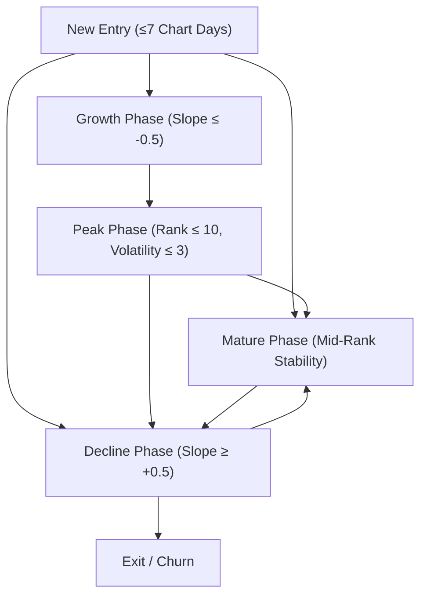

# Spain Top 50: Content Maturity, Release Lifecycle & Playlist Rotation Analysis

**Prepared for:** Atlantic Recording Corporation & Cultural Industry Stakeholders  
**Scope:** 555 daily snapshots of Spain's Top 50 (27,800 raw observations; 555 observed dates from March 2024 to September 2025)  
**Deliverables:** Research Paper, Interactive Streamlit Dashboard (`app.py`), Executive Briefing  

---

## 1. Executive Summary & Core Insights

### Key Findings at a Glance
1. **Low Baseline Churn with Extreme "Shock-Day" Volatility:**
   - On a typical day, Spain's Top 50 is remarkably stable: median daily entries = **1 song/day** (mean = 1.57 songs/day, daily churn rate = **3.1%**).
   - Over **41.1% of days see zero new entries**.
   - However, churn is punctuated by **20 "Shock Days"** (days with $\ge 8$ new entries), accounting for **32.5% of all chart entries**. 17 of these 20 shock days are dominated by single-artist album drops (e.g., Bad Bunny, Rauw Alejandro, Morad).
2. **Lifespan Skew & Day-One Supremacy:**
   - **28.9% of songs exit within 7 days**; **16.1% survive 90+ days**.
   - Censoring-adjusted **Kaplan-Meier Median Survival is 23 days** (mean = 36.1 days).
   - **50.5% of songs achieve their peak rank on their first day of entry**. Debut position is the single strongest predictor of 30-day survival (Top 10 debuts have an **80.0% 30-day survival probability** vs. **17.9% for ranks 41–50**).
3. **Singles Drastically Outlast Album Tracks:**
   - Singles hold a **2.30x longevity advantage** over album tracks (median survival: **30 days for singles vs. 10 days for album tracks**, log-rank $p < 0.001$).
   - Both formats reach the Top 10 at similar rates (**22.3% for singles vs. 20.0% for album tracks**), but album tracks experience severe post-release decay (median stay of shock-entry album tracks is just **2 days**).
4. **Explicit vs. Clean Parity:**
   - Explicit content accounts for **59.9% of songs** and **61.9% of chart slot-days**.
   - Statistical survival testing demonstrates **no significant difference between explicit and clean songs** (log-rank $p = 0.88$, Mann-Whitney $p = 0.77$, Cliff's $\delta = -0.012$, Explicit Content Lifecycle Score = **101**).
5. **Catalog Dominance over Freshness:**
   - Post burn-in analysis reveals that **57.7% of chart slot-days are held by catalog tracks (>90 days old)**, whereas **fresh releases ($\le 30$ days old) occupy only 21.7%**.
   - Top 10 tracks average **92 days on chart**, whereas positions 41–50 average **47 days**.
6. **Popularity Score Lag:**
   - The Atlantic / Spotify popularity API score is a lagging indicator. It ramps up over the first 21 days (from 69.8 to 82.5) and lags chart rank peaks by **~9 days** (median rank peak: Day 0; median popularity peak: Day 9).
   - During the final 14 days before a song exits, its average position deteriorates from 33.2 to 43.5, while popularity remains completely flat (80.1 to 80.4).

---

## 2. Key Performance Indicators (KPIs) Summary

| KPI Name | Value | Strategic Meaning & Methodology |
|---|---|---|
| **Average Days on Playlist** | **36.1 days** (Median: 14.0 d) | Mean chart days per song (observed entries only). Skewed by evergreens. |
| **Median Survival (Kaplan-Meier)** | **23.0 days** | Non-parametric survival accounting for right-censoring. |
| **Entry-to-Peak Time** | **13.6 days** (Median: 0.0 d) | Days from debut to peak rank. 50.5% peak on Day 1. |
| **Playlist Churn Rate** | **3.1% daily** (1.57 songs/day) | Baseline churn excluding shocks is **2.3%** (1.17 songs/day). |
| **Retention Stability Index (RSI)** | **41.5** | $100 \times (1 - \text{Churn}) / (1 + \text{CV of Churn})$; lower due to spiky shock days. |
| **Explicit Content Lifecycle Score** | **101** | Ratio of explicit to clean durability ($100 = \text{parity}$). |
| **Single vs. Album Longevity Ratio** | **2.30x** (Median: 3.00x) | Ratio of single chart tenure to album track tenure. |
| **Freshness Index** | **21.7%** | Share of chart slots held by tracks $\le 30$ chart days old. |
| **Catalog Share** | **57.7%** | Share of chart slots held by tracks $> 90$ chart days old. |
| **Top 10 Turnover Rate** | **7.4% daily** | Average number of new entries into Top 10 per day divided by 10. |

---

## 3. Data Validation, Normalization & Cleaning

The raw data (`data/Atlantic_Spain.csv`, 27,800 rows across 555 days) underwent rigorous auditing:
- **Snapshot Integrity:** 554 days contained exactly 50 entries. `2025-03-01` contained 100 rows representing two duplicate 50-row snapshots; the first snapshot was preserved and 50 duplicate rows dropped.
- **Missing Dates:** 4 calendar dates were missing (`2025-03-14`, `2025-03-25`, `2025-07-11`, `2025-08-13`). These were modeled as data gaps rather than playlist exits; songs spanning across gaps maintained continuous runs, and the subsequent day was excluded from churn computations.
- **String Normalization:** Raw text containing featured artists, accents, and punctuation variations was cleaned. 1,446 raw artist/title strings were consolidated into **1,228 unique standardized Song IDs**.
- **Censoring Controls:** 50 songs charting on Day 1 were flagged as *left-censored* and excluded from duration/survival benchmarks; 50 songs active on Day 555 were treated as *right-censored* in survival analysis.
- **API Zero Popularity:** 106 rows with `popularity == 0` were identified as API dropouts (95% occurring during album drops) and marked as missing rather than true zeroes.

---

## 4. Lifecycle Stage Architecture

Songs are classified daily into five mutually exclusive lifecycle stages based on rolling 7-day velocity ($\Delta \text{Rank}/\text{day}$):

- **Stage Proportions across 27,700 Song-Days:**
  - **Mature:** 66.8% (average dwell: 18.2 days per song)
  - **Decline:** 14.5% (average dwell: 5.7 days)
  - **Peak:** 8.7% (average dwell: 8.6 days)
  - **Growth:** 4.7% (average dwell: 2.2 days)
  - **New Entry:** 5.0% (dwell: 4.8 days)
  - **Unclassified (burn-in):** 0.4%

---

## 5. Machine Learning & Predictive Modeling

### 1. Early Warning Survival Predictor (Day 7 Model)
Using only the first 7 days of chart data, machine learning classifiers predict whether a song will achieve $\ge 30$ days on the Top 50:
- **Gradient Boosting Classifier Test AUC:** **0.78**
- **Logistic Regression Test AUC:** **0.78**
- **Naive Baseline (First-Week Average Position):** **0.67**
- **Feature Importance:** 
  1. 7-Day Rank Slope ($\Delta \text{Rank}/\text{day}$)
  2. Best Position in First 7 Days
  3. Average Position in First 7 Days
  4. Release Type (Single vs. Album)

### 2. Lifecycle Archetype Clustering (K-Means, $k=4$)
- **Evergreen Hits (12.2% of songs, 41.5% of slot-days):** Median 111.5 days, median peak #2.
- **Slow Burners (19.4% of songs):** Median 33.0 days, median peak #18, 56% singles, high re-entry rate (32%).
- **Debut-and-Fade (38.7% of songs):** Median 7.0 days, median peak #36, 68% album tracks entering on shock days.
- **Bottom-Chart Filler (29.7% of songs):** Median 4.0 days, peak > #42.

---

## 6. Strategic Recommendations for Atlantic Recording Corporation

1. **Lead Single Strategy over Album Drops:** Stagger releases by launching 2–3 high-priority singles before dropping full albums. Album drops generate immediate shock entries but experience 80%+ exit rates within 14 days.
2. **Front-Loaded Marketing Budget:** Allocate 70% of promotional spend to pre-save campaigns and release-day playlist pitching. 50.5% of tracks peak on Day 1; post-release recovery is rare for tracks debuting below rank #30.
3. **Day-7 Checkpoint Rule:** Evaluate rank slope on Day 7 using the early warning model. If slope is positive (improving) or stable in Top 25, maintain marketing spend; if slope is deteriorating and rank > 40, reallocate budget to emerging priority tracks.
4. **Disregard Explicit Tag Penalties:** Creative decisions regarding explicit lyrics should not be constrained by playlist longevity concerns in Spain.
5. **Re-Promotion Windows at Decline Stage:** Re-entries occur in 23% of tracks. When a priority single enters the "Decline" stage (ranks 35–45), launch targeted social / remix pushes to prevent playlist drop-off.
